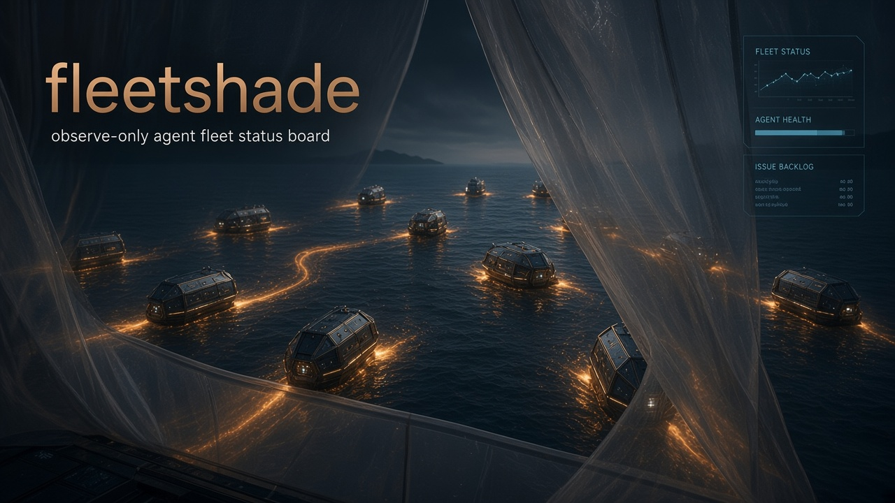

# Fleetshade



**Fleetshade** — DataKnife agent-fleet status board. Observe only: measure the fleet, see the angles, do not steer.

Formerly **dioptra**.

## Status

Mock under [`mock/`](./mock/) — awaiting design approval before implementation.

```bash
python3 -m http.server 8787 --directory mock
```

## Surfaces

1. **Agent infra** — topology of GitHub / GitLab → Fleetshade → Cursor & Hermes → Kubernetes
2. **Kubernetes nodes** — Ready / pressure, coarse CPU · mem
3. **Agent health** — Cursor (Coder + cloud) and Hermes ([coldberth](https://github.com/DataKnifeAI/coldberth) / vLLM)
4. **Issue backlog** — GitHub and GitLab issues, top 10 by priority per platform, with total open counts

## Related

| Project | Role |
|---------|------|
| [slashbay](https://github.com/DataKnifeAI/slashbay) | Intake, triage, berth, dispatch |
| **Fleetshade** | Observe-only status board |
| [helmrail](https://github.com/DataKnifeAI/helmrail) | Fleet deploy + direct (command) |
| [dockfire](https://github.com/DataKnifeAI/dockfire) | Homelab health + admin deep links |

## License

TBD · DataKnifeAI
