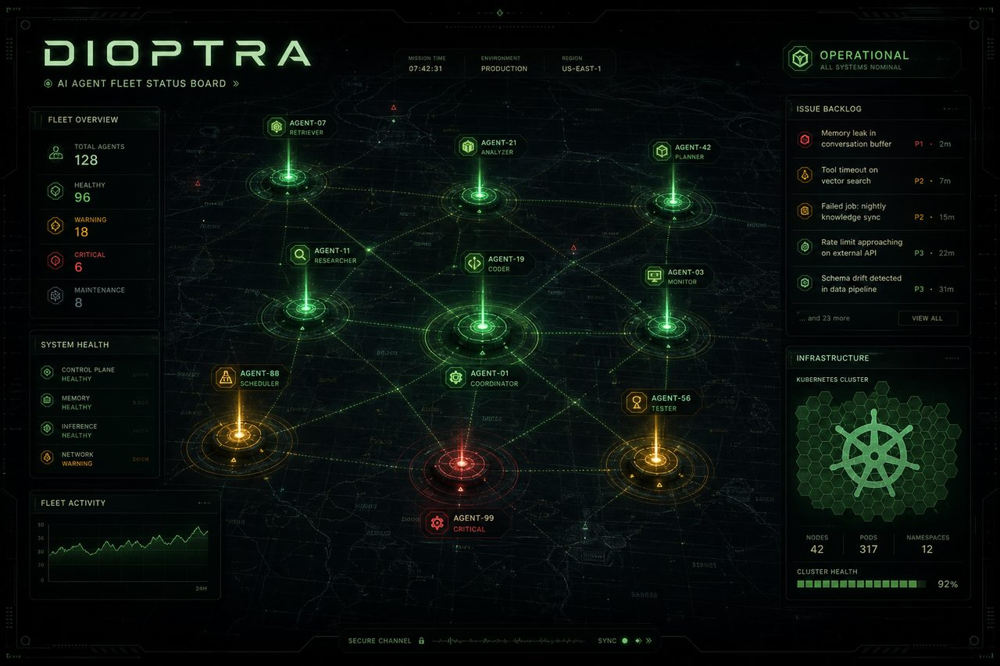

# DIOPTRA




**Dioptra** — DataKnife agent-fleet status board.

Named for the ancient Greek surveying instrument: measure the fleet, see the angles.

## Status

Mock under [`mock/`](./mock/) — awaiting design approval before implementation.

```bash
python3 -m http.server 8787 --directory mock
```

## Surfaces

1. **Agent infra** — topology of GitHub / GitLab → Dioptra → Cursor & Hermes → Kubernetes
2. **Kubernetes nodes** — Ready / pressure, coarse CPU · mem
3. **Agent health** — Cursor (Coder + cloud) and Hermes (Enodios / vLLM)
4. **Issue backlog** — GitHub and GitLab issues, top 10 by priority per platform, with total open counts

## License

TBD · DataKnifeAI
